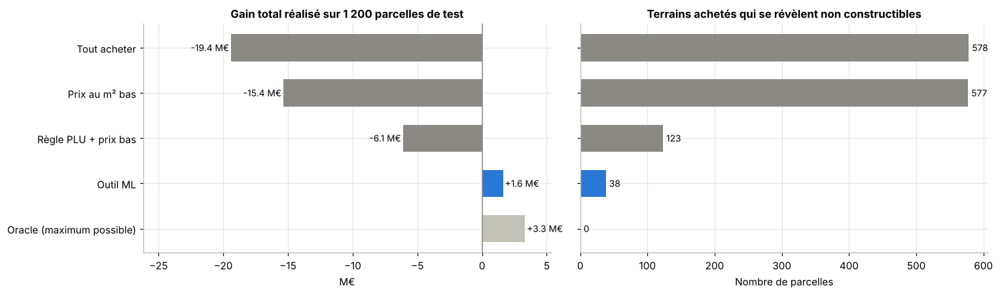
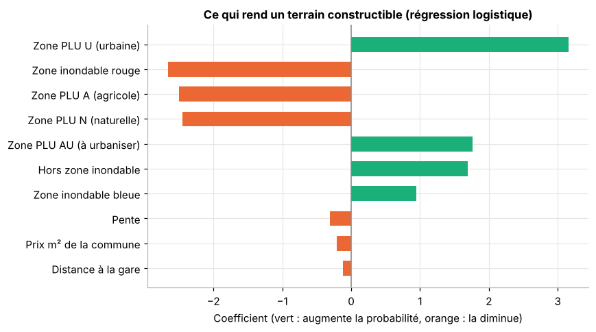
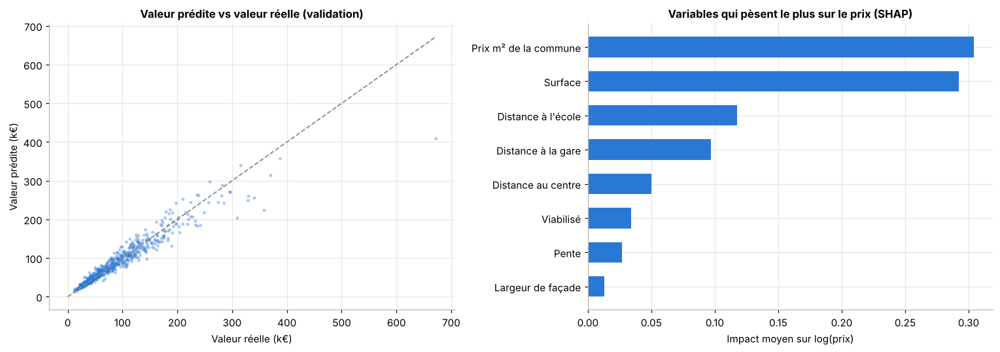

# Analyse de parcelles : faut-il acheter ce terrain pour construire ?

Avant d'acheter un terrain, un particulier, un promoteur ou un constructeur doit savoir trois choses : **peut-on construire dessus**, **combien vaut-il vraiment**, et **combien coûtera la construction en plus** (zone inondable, sol argileux, pente, raccordements).
Ce projet construit un outil d'aide à la décision qui répond à ces trois questions avec du machine learning et rend un verdict : **Acheter**, **Négocier** (avec un prix maximum à proposer) ou **Éviter**.

👉 Tout est dans le notebook : [`notebooks/analyse_parcelles.ipynb`](notebooks/analyse_parcelles.ipynb)

## Résultats

Évaluation finale sur 1 200 parcelles jamais vues pendant l'entraînement :

| Stratégie d'achat | Parcelles achetées | Dont non constructibles | Gain total |
|---|---|---|---|
| Tout acheter | 1 200 | 578 | −19,4 M€ |
| Acheter si le prix au m² est bas | 1 005 | 577 | −15,4 M€ |
| Lire le PLU + prix au m² bas | 547 | 123 | −6,1 M€ |
| **Outil ML** | **128** | **38** | **+1,6 M€** |
| Oracle (maximum possible) | 199 | 0 | +3,3 M€ |

- Les stratégies « intuitives » **perdent de l'argent** : les terrains les moins chers au m² sont souvent ceux qui ne sont pas constructibles (le piège de l'annonce agricole au prix d'un terrain à bâtir).
- L'outil est la **seule stratégie rentable** : il capte environ la moitié du gain maximal possible, avec deux tiers de bonnes affaires parmi ses achats (contre 17 % au hasard).
- Constructibilité : **AUC 0,92** avec une régression logistique (XGBoost fait jeu égal, on garde le modèle le plus simple).
- Prix : **erreur moyenne de 11 %** avec XGBoost, contre 16 % pour un modèle linéaire.

<p align="center">
  
</p>

<p align="center">
  
  
</p>

## Démarche

1. **Constructibilité** (classification) : probabilité que le permis soit accordé, à partir du zonage PLU, du risque inondation (PPRI), de la pente, de la largeur de façade... Le prix demandé n'est volontairement **pas** utilisé : le modèle juge le terrain, pas le vendeur.
2. **Valeur de marché** (régression) : prix du terrain s'il est constructible, appris sur le logarithme du prix (les prix vont de 10 000 € à plus de 500 000 €), expliqué avec SHAP.
3. **Surcoûts de construction** (barème) : zone inondable bleue, argiles, pente, viabilisation.
4. **Décision** : on combine les trois en un gain attendu

   `gain = P(constructible) × (valeur − surcoûts) + (1 − P) × valeur agricole − prix demandé`

   puis : on écarte les terrains dont la constructibilité est incertaine (P < 80 %), on achète si le gain dépasse une marge minimale (choisie sur un jeu de validation), on négocie si une baisse de 10 % suffit.
5. **Évaluation métier** : on mesure l'argent réellement gagné ou perdu, et on compare à des stratégies qu'un acheteur appliquerait sans modèle.

## Analyser une parcelle en ligne de commande

```bash
python analyser_parcelle.py --surface 900 --prix 70000 --zone-plu U --argiles moyen \
    --pente 4 --distance-centre 12 --prix-m2-commune 150
```

```
  Décision : ACHETER  (prix inférieur à la valeur estimée, surcoûts compris)

  Probabilité d'être constructible :        91%
  Valeur estimée si constructible  :     93 800 €
  Surcoûts de construction         :      6 000 €
  Prix demandé                     :     70 000 €
  Gain attendu                     :     10 300 €
  Prix maximum conseillé           :     74 300 €
```

`python analyser_parcelle.py --help` liste toutes les options (zone inondable, terrain non viabilisé, largeur de façade, distances...).

## Lancer le projet

```bash
git clone <url-de-ton-repo>
cd analyse-parcelles
python -m venv .venv && source .venv/bin/activate   # Windows : .venv\Scripts\activate
pip install -r requirements.txt
jupyter notebook notebooks/analyse_parcelles.ipynb
pytest                                              # tests unitaires
```

## Les données

Le jeu `data/parcelles.csv` contient **6 000 parcelles simulées** (régénérables avec `python -m src.simulation`). Chaque variable correspond à une donnée ouverte française réelle :

| Variable | Source réelle équivalente |
|---|---|
| prix, surface, prix au m² de la commune | [DVF](https://www.data.gouv.fr/fr/datasets/demandes-de-valeurs-foncieres-geolocalisees/) (toutes les ventes immobilières depuis 2014) |
| zone PLU (U, AU, A, N) | [Géoportail de l'urbanisme](https://www.geoportail-urbanisme.gouv.fr/) |
| zone inondable, argiles | [Géorisques](https://www.georisques.gouv.fr/) |
| pente | IGN RGE ALTI |
| distances (école, gare) | Base permanente des équipements (Insee) |

Les ordres de grandeur (prix au m² des terrains à bâtir, surcoûts) sont réalistes, mais aucune parcelle ne correspond à un terrain réel : les chiffres de la section Résultats valent pour ce jeu simulé. L'intérêt d'un jeu simulé est de connaître la vérité (le terrain était-il vraiment constructible ? combien valait-il ?), ce qui permet de mesurer précisément l'argent gagné ou perdu par chaque stratégie.

**Passer aux vraies données.** Le module `src/dvf.py` télécharge les ventes DVF d'un département, garde les terrains à bâtir et calcule le prix médian au m² par commune :

```bash
python -m src.dvf --dep 33 --annee 2024     # Gironde -> data/prix_terrains_33_2024.csv
```

## Structure

```
analyse-parcelles/
├── data/parcelles.csv              # 6 000 parcelles simulées
├── notebooks/analyse_parcelles.ipynb
├── src/
│   ├── simulation.py               # génération des parcelles, barème des surcoûts
│   ├── model.py                    # modèles, gain attendu, règle de décision, fiche parcelle
│   └── dvf.py                      # vraies ventes DVF : terrains à bâtir, prix par commune
├── analyser_parcelle.py            # analyse d'une parcelle en ligne de commande
├── scripts/build_notebook.py       # génère le notebook
├── reports/figures/                # graphiques
├── results/                        # tableau des stratégies, paramètres retenus
├── tests/test_projet.py
└── requirements.txt
```

## Limites et pistes

- **Données simulées** : prochaine étape, entraîner le modèle de prix sur les vraies ventes DVF et récupérer zonage et risques parcelle par parcelle via les API du Géoportail de l'urbanisme et de Géorisques.
- **Contraintes invisibles** : une partie des refus de permis (servitudes, avis de l'architecte des Bâtiments de France, recours) n'apparaît dans aucune donnée. L'outil ne remplace pas un certificat d'urbanisme ni une condition suspensive d'obtention du permis dans le compromis.
- **Surcoûts forfaitaires** : en réalité ils dépendent du projet ; une étude de sol G1 et des devis les affinent.
- **Pas de dimension temporelle** : taux d'intérêt et loi Zéro artificialisation nette font évoluer le marché foncier.
- **Pistes** : fourchette de prix (régression quantile), carte interactive, application Streamlit.

## Auteur

**Issa Aziz Karambiri**, étudiant ingénieur en mathématiques appliquées (data, IA, finance).
